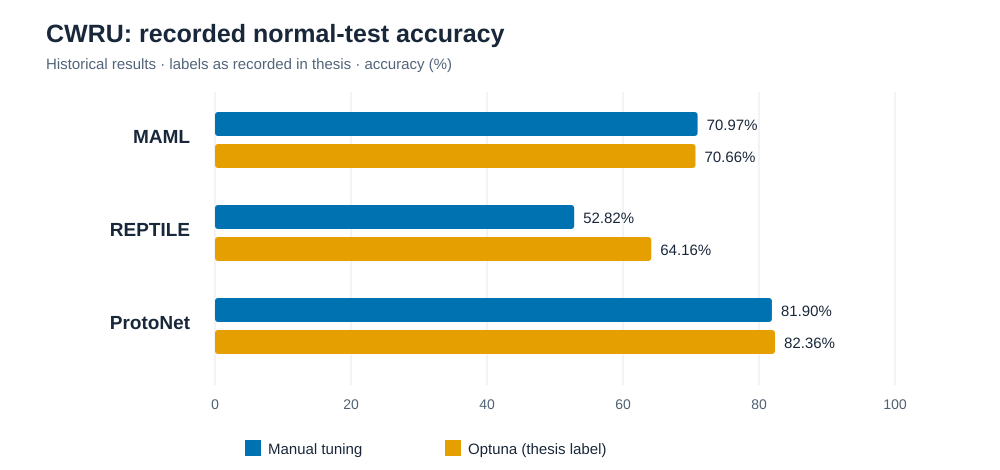
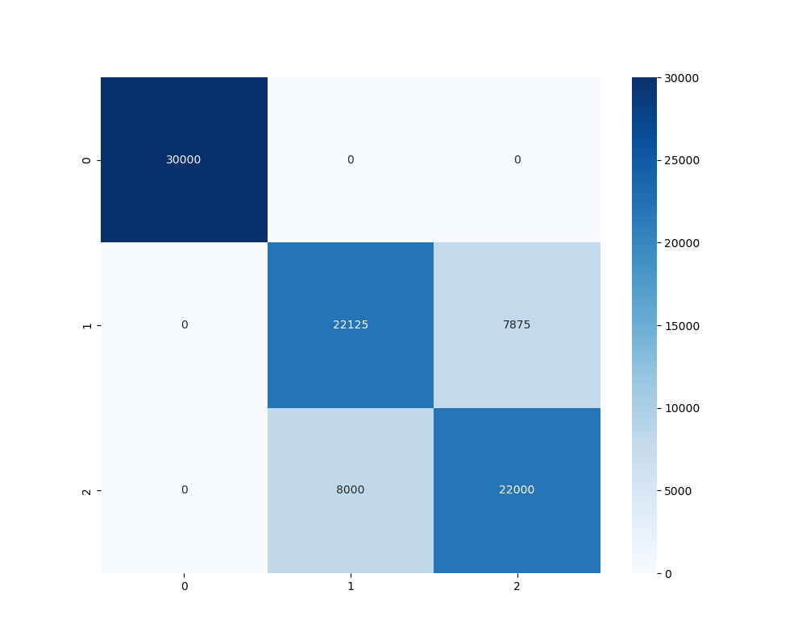

# 基于元学习的电机小样本电机故障分类

本科毕业设计中的电机故障分类研究，尝试在样本较少时，根据振动信号识别不同故障类别。项目包含数据预处理、特征提取、元学习模型训练与测试，以及分类结果的可视化。

## 研究内容

- 使用 CWRU 轴承振动数据及三轴电机轴承振动数据开展实验。
- 以 MAML、Reptile 和 ProtoNet 为对象，尝试构建小样本分类任务。
- 使用 PyTorch 编写模型训练与测试程序，通过 Optuna 搜索部分训练参数，并生成分类报告和混淆矩阵。

## 实验设计

围绕 CWRU 轴承振动数据构建小样本分类任务，比较 MAML、Reptile 与 ProtoNet，并记录手动调参和 Optuna 调参后的测试结果。测试程序以任务形式采样支持集和查询集，再对查询样本进行分类。

## CWRU 实验结果

以下为论文表格与 2025 年 4 月 25 日保存的测试报告中一致的结果。“Optuna”沿用论文中的标注。

| 方法 | 手动调参：正常测试 | Optuna：正常测试 |
| --- | ---: | ---: |
| MAML | 70.97% | 70.66% |
| Reptile | 52.82% | 64.16% |
| ProtoNet | 81.90% | **82.36%** |

在这组记录中，ProtoNet 的正常测试准确率最高。按论文的调参标注比较，Reptile 从 52.82% 提高到 64.16%，相差 11.34 个百分点；ProtoNet 提高了 0.46 个百分点，而 MAML 略有下降。

### 混淆矩阵

下图来自 ProtoNet 的 Optuna 标注结果，测试报告记录准确率为 **82.36%**。矩阵中类别 0 的识别结果集中在对角线，类别 1 和 2 之间仍存在混淆。

[查看该测试报告](results/reports/test_results1_protonet_normal.txt) · [查看六组正常测试报告](results/reports/) · [下载完整结果表](results/cwru_recorded_accuracy.csv)

## 实验结论与后续工作

这组实验展示了三种元学习方法在所记录测试任务上的分类结果，ProtoNet 在正常测试记录中表现较好；不同调参方案对三种方法的影响也不同。

论文还记录了“跨场景”和“跨参数”两类结果，完整数据保留在结果表中。核对当前公开的测试脚本后发现，这两个模式设置的筛选条件没有在数据加载时被使用，因此这些记录暂不能作为跨工况泛化的验证结论。后续需要修正数据筛选、确认训练和测试数据划分，再重新测试。

混淆矩阵汇总的是多次任务采样的预测结果，同一原始样本可能被重复抽取；90,000 条预测不等于 90,000 个互不重复的原始样本。

## 文件

| 文件 | 内容 |
| --- | --- |
| `code/cwru_train.py` | CWRU 数据训练与参数搜索程序 |
| `code/cwru_test.py` | CWRU 测试程序 |
| `code/three_axis_train.py` | 三轴数据训练程序 |
| `code/three_axis_test.py` | 三轴数据测试程序 |

## 运行环境

原程序使用 Python、PyTorch、NumPy、SciPy、h5py、scikit-learn、Matplotlib、seaborn、Optuna 和 higher。脚本中的数据和模型路径对应原实验环境，运行前需要根据本地目录修改配置，并准备相应数据与模型权重。

实验数据集与训练权重未包含在仓库中。
